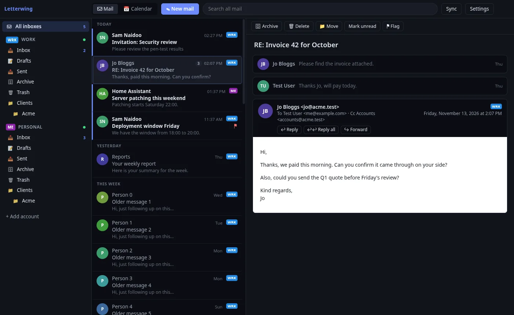

# Letterwing


A customisable desktop mail and calendar app for **Microsoft 365, Google and any IMAP account**. Windows, macOS
and Linux. Website: https://vivianhodgkinson.github.io/Letterwing/



## Install

Download from the [Releases page](https://github.com/VivianHodgkinson/Letterwing/releases/latest), then **+ Add account**:
type your address and sign in with Microsoft or Google in your browser.

| Platform | File | Install |
| --- | --- | --- |
| Windows 10/11 | `Letterwing-<ver>-setup-x64.exe` (or `arm64`) | Run the installer. A `-portable-x64.exe` that needs no install is also provided. |
| macOS | `Letterwing-<ver>-mac-arm64.dmg` (Apple silicon) or `-x64.dmg` (Intel) | Open the .dmg and drag Letterwing to Applications. |
| Fedora, RHEL, openSUSE | `.rpm` | `sudo dnf install ./Letterwing-<ver>-linux-x86_64.rpm` |
| Ubuntu, Debian, Mint | `.deb` | `sudo apt install ./Letterwing-<ver>-linux-amd64.deb` |
| Arch, Manjaro | `.pacman` | `sudo pacman -U ./Letterwing-<ver>-linux-x64.pacman` |
| Any other distro | `.AppImage` / `.tar.gz` | `chmod +x Letterwing-*.AppImage && ./Letterwing-*.AppImage` |

The builds are not code-signed yet: on Windows click *More info → Run anyway* on the SmartScreen prompt, and on macOS
right-click the app and choose *Open* the first time.

**Updates:** the Windows installer and the AppImage update themselves (a *Restart to update* button appears). The
portable exe, the Linux packages and macOS show a *vX available* button that downloads the new file.

## Building from source

```sh
npm install
npm run dev          # hot reload
npm test             # cache, compose, calendar, keymap and IMAP/SMTP end-to-end tests (in-memory servers, no network)
npm run typecheck
npm run dist:linux   # or dist:win / dist:mac (each on its own OS; CI builds all three)
```

The *Sign in with Google / Microsoft* buttons need sign-in apps registered once by whoever builds Letterwing; see
[docs/SETUP.md](docs/SETUP.md). Without them, IMAP accounts still work.

## Releasing

CI (`.github/workflows/build.yml`) tests on Linux, Windows and macOS and builds every package on each push. To release:

```sh
npm version 0.2.0          # bumps package.json and creates the v0.2.0 tag
git push --follow-tags
```

The tag build uploads all installers to a **draft** GitHub Release; review it and click *Publish*. The sign-in IDs
come from repository secrets `GOOGLE_CLIENT_ID`, `GOOGLE_CLIENT_SECRET`, `MICROSOFT_CLIENT_ID`, `MICROSOFT_TENANT`.

## Architecture

```
renderer (React)  ──IPC──▶  main process
                             ├─ db.ts          SQLite cache + FTS5 search (node:sqlite, no native modules)
                             ├─ sync.ts        background sync, one connector per account
                             ├─ oauth.ts       browser sign-in, PKCE + loopback, token refresh
                             ├─ store.ts       settings/accounts JSON; secrets via OS keyring (safeStorage)
                             ├─ calendar.ts    calendar sync, invites, reminders
                             ├─ ical.ts        iCalendar parse/expand/write, iMIP replies
                             └─ connectors/    one class per backend: MailConnector (graph.ts, imap.ts), CalendarConnector (calendar.ts)
                                 ├─ graph.ts   Microsoft 365 via Graph (delta sync)
                                 └─ imap.ts    any IMAP server; Gmail via XOAUTH2
```

The UI only reads from the local cache, so it's fast and works offline. **Adding a backend** (EWS, JMAP, POP3...)
means implementing `MailConnector` in `src/main/connectors/` and adding a case to `connectors/index.ts`.

**Customising:** every colour and size is a CSS variable. Settings → Theme has presets, a colour picker and a raw
JSON box for any variable in `styles.css`. Reading pane right/bottom/off, three densities, per-account badge colours.

Privacy: mail HTML is sanitised (DOMPurify) and shown in a sandboxed iframe with no scripts and its own CSP.
Remote images (tracking pixels) are blocked until you click *Load images*.

**Keyboard:** the Classic scheme by default (`Ctrl+Q` read, `Ctrl+U` unread, `Insert` flag, `Ctrl+E`/`F3` search,
`F9` send/receive, `Ctrl+.`/`Ctrl+,` next/previous...). Settings → Keyboard switches to the Single-key scheme or rebinds any
action, including multi-key sequences like `G I`, with conflict warnings. Shortcuts live in `src/shared/keys.ts`: a new
action is one entry in `ACTIONS` plus a handler in `App.tsx`. `F12` opens devtools.

## Roadmap

- [x] **M1 - Read:** accounts (M365, Google, IMAP), folder tree, unified inbox, sync, offline cache, search, flags, themes
- [x] **M2 - Write:** compose/reply/reply all/forward (business-style quoting), HTML signatures per account, drafts saved
      to the server, send (SMTP / Graph, big attachments via upload sessions), move/delete/archive with drag-to-folder,
      multi-select, open/save attachments, inline images, IMAP IDLE push (Graph: 1-minute poll), notifications,
      conversations, address autocomplete, older mail loads as you scroll
- [ ] **M2 follow-ups:** offline outbox, undo send, list virtualisation for very long folders, CONDSTORE for big IMAP folders
- [x] **M3 - Calendar:** Microsoft 365 (Graph), CalDAV (Google, iCloud, Fastmail, Nextcloud) and ICS subscriptions;
      day / work week / week / month views, mini month, per-calendar toggles; create, edit, delete, simple repeats,
      invite people, Teams meetings; Accept / Tentative / Decline from the calendar or from the invitation in mail
      (iMIP replies for non-Microsoft accounts), clash warnings, reminders
- [ ] **M3 follow-ups:** drag to move/resize events, editing repeating CalDAV events, custom repeat rules, free/busy
      lookup when inviting
- [ ] **M4:** contacts and address autocomplete, rules, snooze, templates, keybinding editor, EWS (on-prem Exchange), JMAP

## Checking UI changes without clicking

`LETTERWING_CAPTURE` runs the app in an offscreen window on a profile of your choice, performs scripted steps and saves
screenshots, then quits:

```sh
LETTERWING_PROFILE=/tmp/letterwing-test LETTERWING_CAPTURE=/tmp/shots \
LETTERWING_STEPS='[["wait",1500],["shot","inbox"],["js","document.querySelector(\".msg\").click()"],["wait",800],["shot","reader"]]' \
npx electron .
```
